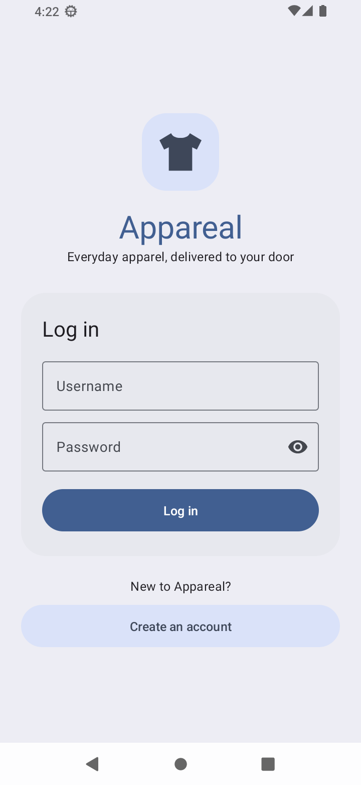
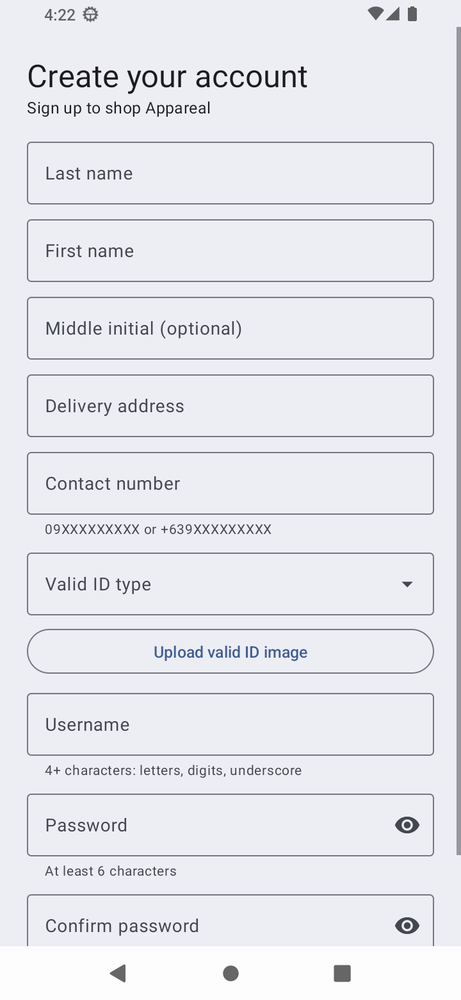
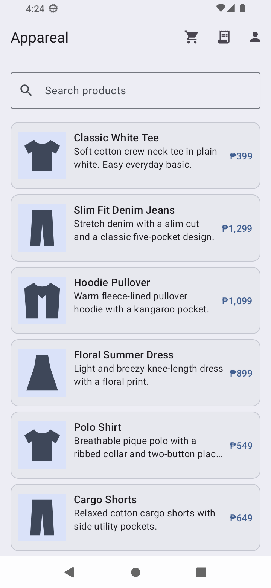
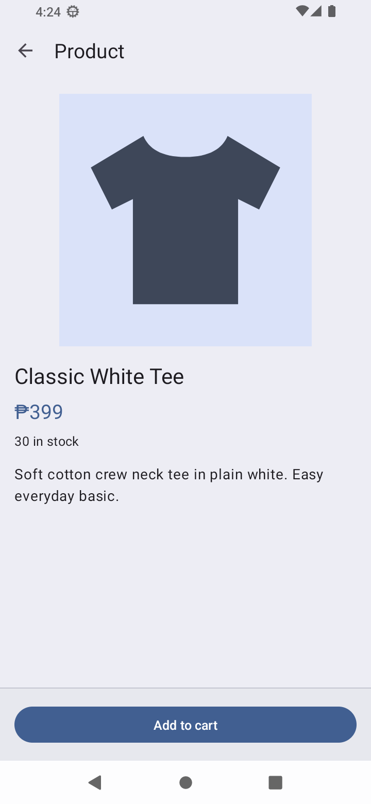
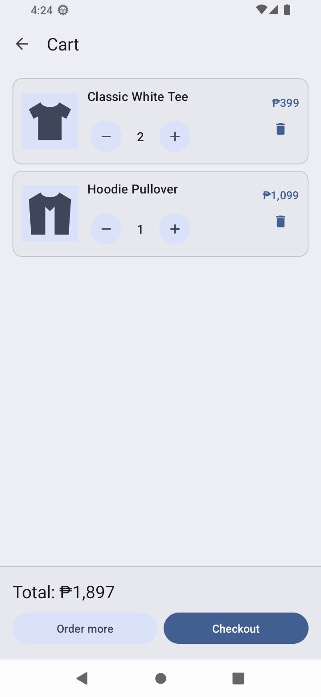
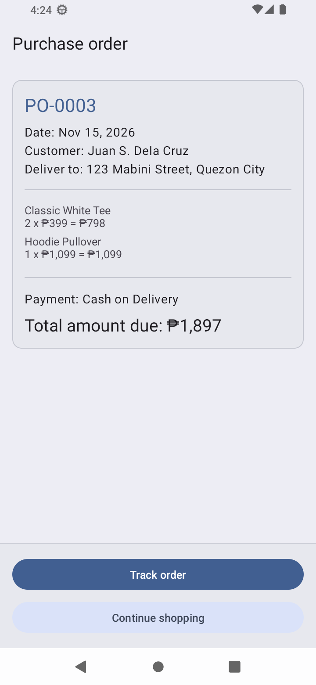
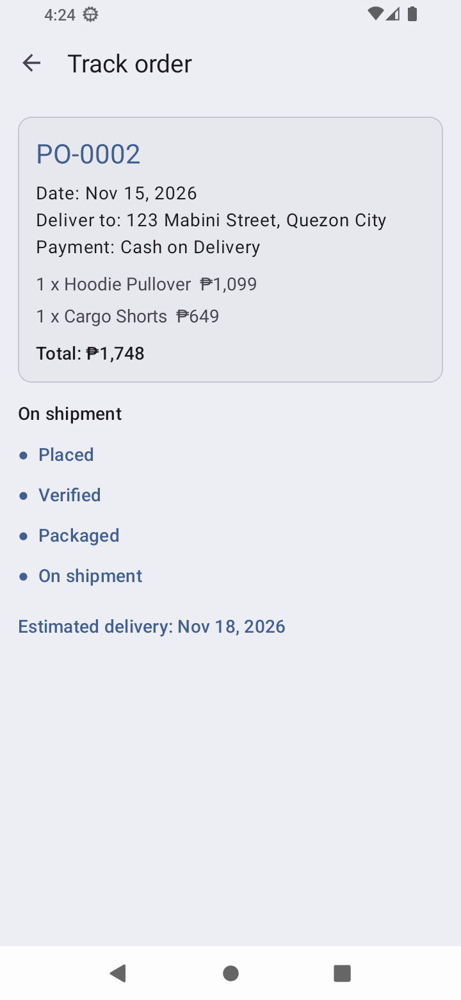
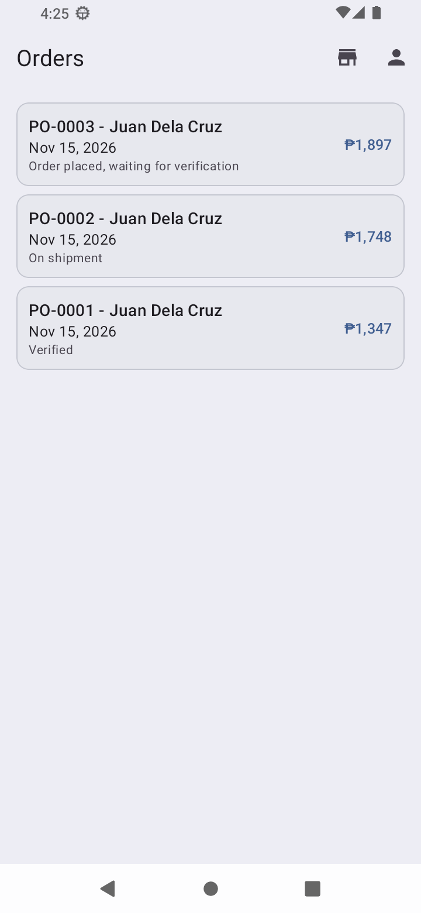
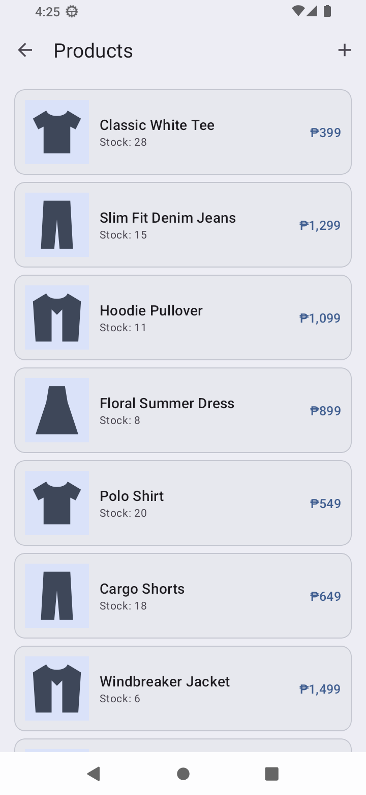

# Appareal

An Android app for a medium-scale apparel store. Customers sign up, browse and search the catalog, order through a cart, pay Cash on Delivery and track the status of their order. The store manager sets each order to Verified, Packaged or On shipment with an estimated delivery date, and lists new products. The whole app works offline with no backend.

**Core flow:** Customer signs up → Logs in → Browses and searches → Adds to cart → Checks out (COD) → Gets the PO receipt → Tracks the order

**Manager flow:** Logs in → Sets order statuses (and the delivery date) / Adds products to the catalog

## About

Appareal is the competition project built for the Tagisan ng Talino 2024 - 2025 Code Fest hackathon, where it won **1st Place (Champion)**. It is a simulation: everything is stored on the device in SQLite, and there is no server, payment gateway, email, SMS or real push notification.

| | |
|---|---|
| Team Name | Yukinians |
| Result | 1st Place (Champion), Tagisan ng Talino 2024 - 2025 Code Fest |
| Team Members | [Vrixzandro Eliponga](https://github.com/mowtiie), [Michael Tagle](https://github.com/ImmunoCapacity), [Xean Stephen Atatado](https://github.com/771Folders) |

## Features

**Registration and authentication**
- Sign up as a customer with a last name, first name, optional middle initial, delivery address, contact number, valid ID type, valid ID image, username and password. Names accept letters, spaces, hyphens and apostrophes. The contact number is `09XXXXXXXXX` or `+639XXXXXXXXX`, the address is at least 10 characters, the username is at least 4 letters, digits or underscores and must be unique, and the password is at least 6 characters
- The valid ID is one of SSS, PhilHealth, Driver's License, PRC License or National ID, and the ID image is picked from the device and shown as a thumbnail
- Log in with a username and a password. The stored account decides which home screen opens, the customer store or the manager orders

**Customer**
- Catalog shows the product image, description and price. The search field filters live as you type, matching the name and description
- Product Detail shows a large image, description, price and stock. Out of stock products cannot be added. Adding a product offers to order more or go to checkout
- Cart lists the items with a quantity stepper, capped at the stock, and a delete button with an Undo. A sticky bar shows the total with Order more and Checkout
- Checkout shows the order summary, an editable delivery address and the fixed payment, Cash on Delivery. Placing the order lowers the stock
- The PO receipt shows the PO number, date, customer, delivery address, every product with its quantity and price, the payment and the total amount due
- My Orders lists your orders newest first. Order Tracking shows a four step tracker (Placed, Verified, Packaged, On shipment) and the estimated delivery date once the order is on shipment
- Profile shows your details and ID image, and lets you log out

**Store manager**
- Orders lists every customer's order newest first with the status
- Order detail lets you set the status to Verified, Packaged or On shipment. On shipment needs an estimated delivery date that is today or later
- Product Listing shows all products. Add a product, or edit an existing one, from a bottom sheet with the image, name, description, price and stock. A saved product shows up in the customer catalog and search right away

**Messages**
- Every action gets feedback: account created, wrong login, item added, stock limit reached, item removed (with Undo), order placed, status updated and product saved, with inline errors on the wrong field
- Notifications are in-app only, with no Android notifications or channels

## Tech specs

| | |
|---|---|
| Language | Java 11 |
| UI | XML layouts, Material Design 3 (Material Components 1.14), view binding |
| Min / target SDK | 29 (Android 10) / 36 |
| Build | Android Gradle Plugin 9.2.1 |
| Storage | Local SQLite for users, products, cart, orders and order items |
| Media | System image picker (`GetContent`), no permissions needed. Picked images are shrunk and copied into the app's own storage |
| Theme | Material Theme Builder palette, light and dark |
| Navigation | One Activity per screen, no fragments |
| Libraries | AndroidX AppCompat, Activity, ConstraintLayout and Material Components only |

## Requirements

- Android Studio (a recent version that supports AGP 9.x) and JDK 11 or newer
- An Android emulator or device running Android 10 (API 29) or higher

## Getting started

```bash
git clone https://github.com/mowtiie/Appareal.git
cd Appareal
./gradlew assembleDebug
```

Then open the project in Android Studio and press **Run** on an emulator. The debug APK is created at `app/build/outputs/apk/debug/`.

## Demo accounts

Demo data is seeded when the database is first created, so you can log in and look around without adding anything.

| Username | Password | Role | Data |
|---|---|---|---|
| `customer` | `demo1234` | Customer | 2 orders, one Verified and one On shipment with an estimated delivery date |
| `storemngr` | `St!apparel01` | Store Manager | The full order list and the product listing |

The seed also adds 8 products with stock. You can also create your own customer account on the sign up screen.

## Notes

- Data is saved in local SQLite and persists across restarts.
- The database is recreated when its version changes, so upgrading across a schema change clears the saved data.
- Accounts are simulated. Passwords are stored as plain text in the local database, so do not use a real password.
- There is no password reset and no profile editing.
- Only customers sign up. The store manager account is seeded.
- Images are shrunk to about 800 px before they are saved. The seed products use bundled placeholder drawings.

## Screenshots

<div align="center">
	<div>
         
         
         
         
         
         
         
         
         
	</div>
</div>

## Release build

```bash
./gradlew assembleRelease
```

Release builds are minified and shrunk. To sign them, copy `keystore.properties.example` to `keystore.properties` in the project root and fill in your keystore path, alias and passwords. Without that file `assembleRelease` still builds, but the APK is unsigned (`app-release-unsigned.apk`). The signed APK is created at `app/build/outputs/apk/release/`.

Keystore files and `keystore.properties` are git-ignored and must never be committed.

## Verification

APK releases on GitHub are signed using my key. They can
be verified using
[apksigner](https://developer.android.com/studio/command-line/apksigner.html#options-verify):

```
apksigner verify --print-certs --verbose appareal.apk
```

The output should look like:

```
Verifies
Verified using v1 scheme (JAR signing): false
Verified using v2 scheme (APK Signature Scheme v2): true
Verified using v3 scheme (APK Signature Scheme v3): false
Verified using v3.1 scheme (APK Signature Scheme v3.1): false
Verified using v3.2 scheme (APK Signature Scheme v3.2): false
Verified using v4 scheme (APK Signature Scheme v4): false
```

The certificate fingerprints should correspond to the ones listed below:

```
Owner: CN=Mowtiie
Issuer: CN=Mowtiie
Serial number: 8a256fdcdde50069
Valid from: Wed Jun 10 22:57:23 PST 2026 until: Sun Oct 26 22:57:23 PST 2053
Certificate fingerprints:
         SHA1: 56:4E:2C:DB:E4:06:C9:EC:15:E6:BC:D9:0A:88:38:72:8B:FB:13:20
         SHA256: 8B:67:51:F3:C3:31:85:63:5F:98:95:30:B6:C0:73:A1:39:7B:3D:41:2B:EF:AE:69:06:A2:EB:58:45:D2:DE:63
```

**Warning:** Only install Appareal APKs signed with the key above. Verifying the signature confirms you're running a genuine, unmodified build.

### PGP Signing

As an additional layer on top of the Android signature above, each release is also signed with my PGP key. While `apksigner` confirms the APK itself is intact, a PGP signature confirms that *I* am the one who published this specific file to GitHub — an independent check that doesn't rely on GitHub's account security alone.

**Public key fingerprint:**
```
9EA2 8F46 7802 5092 7643 1B69 42B5 FA42 AA63 90E1
```

Download and import the key from my website, or directly from this repo:

```
curl -O https://mowtiie.cc/PGP_PUBLIC_KEY.asc
gpg --import PGP_PUBLIC_KEY.asc
```

After importing, confirm the fingerprint printed by GPG matches the one listed above — that match is what actually establishes trust, not the import step itself. Fetching the key over HTTPS from a domain you already trust is arguably a stronger anchor than a keyserver, since keyservers accept uploads from anyone and don't vouch for identity.

Each release includes a detached `.asc` signature alongside the APK. Verify a downloaded release with:

```
gpg --verify appareal-X.X.apk.asc appareal-X.X.apk
```

A valid signature looks like:

```
Good signature from "Mowtiie <mowtiie.dev@gmail.com>"
```

**Note:** PGP signing is a supplementary trust measure, not a substitute for the `apksigner` check above — verify both if you want the highest confidence that a release is genuine and unmodified.

## License

Appareal is released under the [MIT License](LICENSE).
